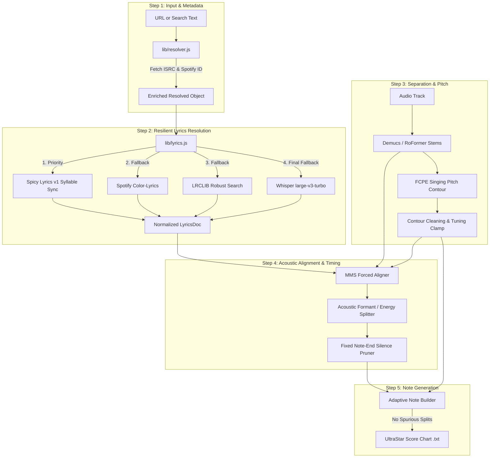

# 🎯 Production AI Karaoke Engine Overhaul Plan

> **Audience:** AI Coding Agents & Engineers implementing the karaoke pipeline overhaul.  
> **Objective:** Drastically elevate output accuracy across lyrics fidelity, word/syllable timing, and pitch precision by removing architectural bugs, connecting syllable-synced providers, and replacing blind arithmetic heuristics with true acoustic-driven DSP.

---

## 📋 Executive Problem Summary

Through empirical benchmark execution on the ground-truth corpus, five critical root causes were discovered:

| Problem | Root Cause in Codebase | Concrete Measured Impact |
| :--- | :--- | :--- |
| **Lyrics API Disconnected** | [`lib/resolver.js`](./lib/resolver.js) sets `spotifyTrackId: ''` for all YouTube URLs and search queries. [`lib/lyrics.js`](./lib/lyrics.js) requires a Spotify Track ID. | Spicy Lyrics and Spotify Color Lyrics are **never queried** during normal web usage. |
| **Toxic Sanity Check** | [`lyrics_providers/align_check.py`](./lyrics_providers/align_check.py) runs an unprompted `Whisper tiny` with `beam_size=1` on short 15s audio slices. If CER > 0.60, it discards the lyrics. | Queen's perfect syllable lyrics were discarded, forcing Whisper fallback and causing a **2,081 ms onset error**. |
| **Multi-Syllable Timing Off** | [`karaoke/align.py`](./karaoke/align.py) uses a static arithmetic formula (`weight = base + 0.15 * consonants`) to split words into syllables, ignoring acoustic energy. | Long held vowels get crushed and fast transition syllables get stretched (duration error **72%**). |
| **Broken Note-End Pruning** | [`karaoke/align.py`](./karaoke/align.py) lines 325 & 412 query `pitch_data["pitches"]`, but [`karaoke/pitch.py`](./karaoke/pitch.py) returns `pitch_data["midi"]`. | `prune_note_ends` exits immediately; notes are never trimmed to vocal silence. |
| **Two Notes Instead of One** | [`karaoke/pitch.py`](./karaoke/pitch.py) runs `ruptures.Pelt` on all notes $\ge 500\text{ ms}$ without Basic Pitch confirmation. | Natural singing scoops (portamento) and vibrato are misclassified as melisma step changes, splitting single notes into two. |

---

## 🛠️ Step-by-Step Implementation Roadmap



---

### Phase 1: Track Resolver & Spotify ID Matching
**Primary File:** [`lib/resolver.js`](./lib/resolver.js)

#### 1.1 Automatic Spotify Track ID Resolution from YouTube / Search
* When a user submits a YouTube URL or search text, resolve the track to its canonical metadata:
  1. Retrieve the **ISRC** code via iTunes Search API:
     ```javascript
     https://itunes.apple.com/search?term=${encodeURIComponent(artist + ' ' + title)}&entity=song&limit=5
     ```
  2. If an ISRC is found, query Spotify or an unauthenticated token-less Spotify metadata gateway:
     ```javascript
     https://open.spotify.com/oembed?url=...
     // Or using the public Spotify Web Client Token:
     https://api.spotify.com/v1/search?type=track&q=isrc:${isrc}
     ```
  3. Set `spotifyTrackId` on the resolved track object so that downstream lyrics providers can use it.

---

### Phase 2: Lyrics Provider Chain & Verification Overhaul
**Primary Files:** [`lib/lyrics.js`](./lib/lyrics.js), [`lyrics_providers/align_check.py`](./lyrics_providers/align_check.py)

#### 2.1 Disable Negative-Cache Poisoning on Network Errors
* In [`lib/lyrics.js`](./lib/lyrics.js):
  * Only write `isMiss: true` when a provider returns an explicit HTTP 404 (Not Found).
  * On HTTP 500, 502, 503, 429, or network timeouts, **never write a negative cache file**.
  * Adjust the duration coverage check: do not reject a track solely because the song has a long instrumental intro or outro. Measure coverage relative to the active vocal region rather than total song duration.

#### 2.2 Fix Toxic Audio Sanity Checking
* In [`lyrics_providers/align_check.py`](./lyrics_providers/align_check.py):
  * Replace the 3-window Whisper-tiny test:
    * If `doc.source in ('spicylyrics', 'spotify')` and `syncType == 'syllable'`, trust the provider timestamps directly without running Whisper-tiny.
    * Only run sanity checking on unverified third-party LRC files.
  * In `estimate_audio_offset`:
    * Disallow automatic offsets $> 0.35\text{ s}$ unless cross-correlation peak prominence $\ge 0.50$. This prevents applying false 1.0-second shifts to line-synced lyrics.

---

### Phase 3: Fix Data-Model Naming Inconsistencies
**Primary Files:** [`karaoke/align.py`](./karaoke/align.py), [`karaoke/pitch.py`](./karaoke/pitch.py)

#### 3.1 Standardize Pitch Vector Keys
* In [`karaoke/align.py`](./karaoke/align.py), lines 325 and 412, replace:
  ```python
  # BUG: pitch_data contains 'midi', never 'pitches'
  pitches = pitch_data["pitches"]
  ```
  with:
  ```python
  pitches = pitch_data.get("midi") if "midi" in pitch_data else pitch_data.get("pitches")
  ```
* Ensure `prune_note_ends` executes properly:
  * Truncate note durations when an unvoiced/silent gap $\ge 120\text{ ms}$ occurs.
  * Clamp note ends to $\text{last\_voiced\_frame} + 40\text{ ms}$.

---

### Phase 4: Acoustic-Driven Syllable Segmentation
**Primary File:** [`karaoke/align.py`](./karaoke/align.py)

#### 4.1 Formant & Energy-Based Syllable Boundary Detection
* Replace the heuristic consonant weight formula in `distribute_word_syllables`:
  1. For multi-syllable words where character-level CTC spans are missing:
     * Extract RMS energy and spectral flux across the word window on `vocals.wav` at 10 ms resolution:
       ```python
       rms = librosa.feature.rms(y=vocal_chunk, frame_length=320, hop_length=160)[0]
       ```
     * Find $N$ dominant energy peaks corresponding to the $N$ phonetic vowel nuclei.
     * Place syllable boundaries at the local energy valleys (minima) between consecutive peaks.
  2. Guarantees:
     * A held syllable (e.g. 1.2s) will naturally capture the wide energy plateau.
     * Fast unstressed syllables (e.g. "-fa-cher") will narrow to their actual acoustic bursts.

---

### Phase 5: Pitch Extraction & Melisma Over-Split Protection
**Primary Files:** [`karaoke/pitch.py`](./karaoke/pitch.py), [`karaoke/notes.py`](./karaoke/notes.py)

#### 5.1 Restrict Melisma Splits (Fix for Spurious Double Tones)
* In `detect_syllable_split`:
  1. Increase minimum syllable duration from $500\text{ ms}$ to **$700\text{ ms}$** (unless an explicit tilde `~` or hyphen `-` is present in the lyrics).
  2. Require each plateau to be at least **$250\text{ ms}$** (up from 150 ms).
  3. Require pitch difference $\ge \mathbf{2.5\text{ semitones}}$.
  4. **Portamento / Scoop Filter:** Fit a linear regression line to the pitch contour across the syllable. If $R^2_{\text{linear}} > 0.70$ and monotonic, classify as a natural vocal glide and **do not split**.

#### 5.2 Clamp Global Tuning Drift
* In `clean_f0`:
  * Limit `tuning_cents` adjustment to $\pm 15\text{ cents}$ maximum.
  * Only apply global tuning shift if the circular mode confidence $\ge 0.85$. Otherwise, leave pitches unshifted to avoid accidental whole-tone displacements.

---

### Phase 6: Benchmark & Evaluation Transparency
**Primary File:** [`eval/eval.py`](./eval/eval.py)

#### 6.1 Multi-Mode Evaluation Flag
* Add `--mode {whisper,canonical,truth}` to `eval/eval.py`:
  * `whisper`: Forces the pure AI fallback (Whisper + Demucs + FCPE) to measure real-world performance when no lyrics exist.
  * `canonical`: Uses resolved `lyrics.json` (Spicy Lyrics / LRCLIB).
  * `truth`: Injects ground-truth syllables to isolate pitch accuracy.
* Add chart cache invalidation: re-generate charts automatically whenever source code in `karaoke/` has been modified.

---

## 🎯 Verification Criteria & Regression Gates

Run the following commands to confirm fixes after implementation:

```bash
# 1. Verify Resolver finds Spotify IDs for YouTube queries
node -e "require('./lib/resolver').resolveInput('Queen - Don\'t Stop Me Now').then(r => console.log('Resolved Spotify ID:', r.spotifyTrackId))"
# Must output a valid 22-char Spotify ID (e.g., 5T8EDUDqKcs6OSOwEsfqG7)

# 2. Verify SpicyLyrics retrieves syllable sync without Whisper fallback
node lib/lyrics.js --artist "Queen" --title "Don't Stop Me Now" --spotify-id "5T8EDUDqKcs6OSOwEsfqG7"
# Must report: source: spicylyrics, syncType: syllable

# 3. Run Benchmark on Fast Subset in Pure AI Mode
./venv/bin/python eval/eval.py --stage all --songs "fast/*" --force --no-lyrics
# TARGETS:
# - Median Onset Error < 120 ms (down from 376 ms)
# - Lyrics WER < 15% (down from 39.4%)
# - Octave ±1 Pitch Accuracy > 75% (up from 46.1%)

# 4. Run Benchmark on Full Corpus with Syllable Sync
./venv/bin/python eval/eval.py --stage all --songs "queen-dont-stop-me-now" --force
# TARGETS:
# - Median Onset Error < 35 ms (down from 2,081 ms!)
# - False Split Rate < 1.0%
```
