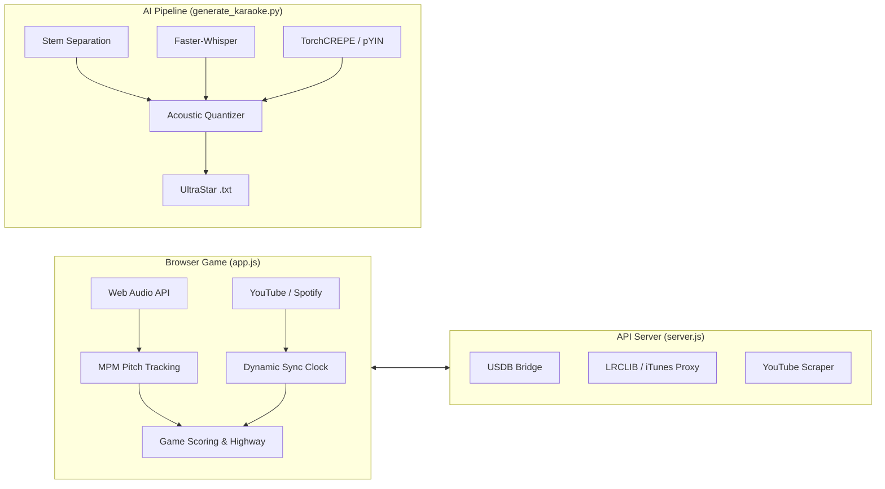

# 🎤 SING! Web Studio & AI Karaoke Engine

A full-stack, browser-based **SingStar / Let's Sing-style karaoke game** featuring real-time pitch detection, YouTube & Spotify streaming, and a high-accuracy **AI Pipeline** that automatically converts any MP3/WAV into an UltraStar note chart (`.txt`) and separated instrumental track.

---

## 🌟 Key Highlights

- **🎮 60 FPS Web Karaoke Game**:
  - Live pitch highway rendering with note capsules, vibrato tracking, combo multipliers, particle effects, and scoring.
  - **Render-Time Spacing**: Canvas highway renders clean visual spacing between adjacent notes without altering the underlying millisecond chart timestamps.
  - **Interactive Chart Editor**: In-browser piano roll and pitch highway editor (`#modalChartEditor`) allowing full pitch shifts (±1 / ±12 semitones), timing nudges (±50ms), melisma splitting, syllable editing, audio preview playback, and saving directly back to `songs/<slug>/song.txt` (`POST /api/library/:slug/chart`).
  - In-browser **McLeod Pitch Method (MPM)** on raw Web Audio PCM streams with sub-cent parabolic refinement and median filtering.
  - **Dual Playback Engine**: Seamless streaming via embedded **YouTube IFrame API** (with automatic anti-embed-block fallbacks) or **Spotify Web Playback SDK** (lossless audio via OAuth 2.0 PKCE).
  - **Massive Song Library**: 6,682+ pre-indexed UltraStar songs (`public/ultrastar_index.json`), live integration with the USDB community database (28,000+ charts), and universal fallback search across LRCLIB & iTunes.
  - **Dynamic Audio Sync**: Real-time offset micro-adjuster and one-click *"Studio Sync"* / *"1st Syllable Snap"* to guarantee lyrics line up with audio.

- **🤖 AI Karaoke Generation Pipeline (`generate_karaoke.py`)**:
  - **Stem Separation**: Meta's `demucs` (`htdemucs`) extracts clean vocal and instrumental stems.
  - **Speech-to-Text & Word Timings**: `faster-whisper` (`small` model, int8 quantization) segments singing into word boundaries.
  - **Dual Neural/Viterbi Pitch Tracking**: Select between `torchcrepe` (neural pitch inference) or `librosa.pyin` (fast probabilistic tracking).
  - **Phonotactic Syllable Engine**: Monosyllable protection dictionary for English & German (*"dance"*, *"breathe"*, *"traum"* are never over-split) + hyphenation via Pyphen.
  - **Acoustic Quantization & Musical In-Key Snapping**: Automatic Krumhansl-Schmuckler song key detection, transient consonant trimming (focusing on the vowel core 70%), subharmonic octave folding, and 10 ms grid beat quantization (UltraStar `#BPM:1500`).

- **🧬 Multi-Island Evolutionary Genetic Optimizer (`optimizer.py`)**:
  - 8-island parallel genetic algorithm with periodic migration and extinction mechanics.
  - Optimizes a 12-dimensional continuous and discrete acoustic chromosome against human-annotated ground-truth charts.

---

## 📂 Project Structure

```text
.
├── server.js                      # Zero-dependency Node.js HTTP server & API Gateway
├── package.json                   # Web app metadata & startup script
├── public/                        # Client-side web application
│   ├── index.html                 # Main single-page app layout (Lobby, Stage, Modals)
│   ├── style.css                  # Modern dark glassmorphism styling & animations
│   ├── app.js                     # Complete client-side game engine & Web Audio DSP
│   └── ultrastar_index.json       # Pre-indexed metadata for 6,682 UltraStar songs
├── generate_karaoke.py            # CLI AI pipeline: Audio -> UltraStar TXT + Playback
├── optimizer.py                   # Multi-island genetic optimizer for parameter tuning
├── requirements.txt               # Python ML/audio processing dependencies
├── tests/
│   ├── engine_test.js             # Automated JS unit tests (MPM, catalog, offset sync)
│   └── test_karaoke_pipeline.py   # Python unit tests (phonetics, pitch, TXT exporter)
├── usdb_cache/                    # Local cache directory for fetched USDB song charts
└── output/                        # Default export directory for generated charts & stems
```

---

## 🚀 Quick Start

### 1. Web Karaoke Game

#### Prerequisites
- Node.js (v16+)

#### Start Server
```bash
# Start the local server
npm start
# or: node server.js
```
Open your browser and navigate to:
```
http://localhost:3000
```

#### Playing Songs
1. **Search**: Enter any artist or song title (e.g., *Queen*, *ABBA*, *Oasis*, *Adele*, *Apache 207*).
2. **Audio Mode**:
   - **📺 YouTube**: Enabled by default. Uses high-ranking official/lyric videos with automatic fallback if embedding is blocked.
   - **🟢 Spotify**: Click the top Spotify badge to log in with your Spotify Premium account (uses OAuth 2.0 PKCE, no client secret required on server).
3. **Microphone**: Allow microphone permissions. Sing into your mic; your detected pitch will be mirrored on the visual highway in real-time.

---

### 2. AI Karaoke Generator (MP3 to UltraStar)

Convert any custom MP3 or WAV file into an UltraStar `.txt` score chart and backing track.

#### Prerequisites
- Python 3.10+
- Virtual environment with dependencies installed:

```bash
python3 -m venv venv
source venv/bin/activate
pip install -r requirements.txt
```

#### Run the Generator
```bash
python generate_karaoke.py "path/to/song.mp3" --artist "Artist Name" --title "Song Title"
```

#### Useful CLI Flags
- `--pitch-engine fcpe|crepe|pyin` : Select pitch algorithm (default `fcpe` neural singing model).
- `--quality fast|balanced|best` : Dynamic hardware profile tier.
- `--separator demucs|roformer` : Select vocal/stem separation engine.
- `--use-basic-pitch` : Enable Spotify Basic Pitch as second-opinion voting for melisma splits.
- `--debug-dir <path>` : Export high-resolution `contour.png` and `report.json` for acoustic debugging.
- `--json-progress` : Machine-readable SSE relay progress streaming.
- `--key "Eb"` or `--key "Cm"` : Specify or override detected musical key.
- `--vocal-range auto|female|male` : Calibrate fundamental frequency search bounds.

**Generated Outputs** (in `./output/`):
- `Artist - Title.txt` : The complete UltraStar formatted lyric and melody chart.
- `Artist - Title [Instrumental].wav` : High-quality instrumental backing track separated by Demucs.

---

### 3. Evolutionary Parameter Optimizer

To evolve parameter sets against a human-verified ground truth chart:

```bash
python optimizer.py "path/to/song.mp3" --ground-truth ground_truth_sample.json
```
The optimizer will run parallel islands, periodically migrating top performers and saving the winning parameter set to `output/best_karaoke_params.json`.

---

## 🧪 Testing & Verification

The project includes full unit test suites and an automated benchmark regression gate:

### Complete Regression Gate (Recommended)
```bash
bash scripts/check.sh
# or: npm run test:regression
```
*Executes all JavaScript unit tests (Resolver, Jobs, Library, Engine MPM DSP), Python AI pipeline unit tests (55 tests), and runs benchmark evaluation on a fast 3-song corpus subset (`fast/*`), strictly verifying no accuracy metric regresses by > 2 percentage points against baseline.*

### Individual Test Suites
```bash
# Node.js tests (Resolver, Jobs queue, Library streaming, Engine DSP)
npm test

# Python AI pipeline tests
./venv/bin/python -m unittest discover tests

# Benchmark evaluation against ground-truth corpus
./venv/bin/python eval/eval.py --stage all --songs "fast/*"
```

---

## 📐 Architecture Overview



For an in-depth breakdown of mathematical formulas, DSP implementations, and component interactions, refer to [`AGENTS.md`](./AGENTS.md).
