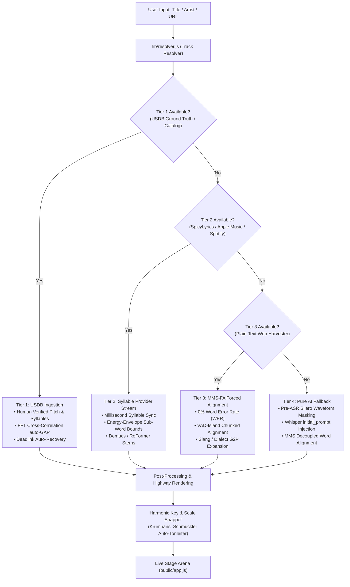

# 🚀 Master Overhaul Plan: 4-Tier Consistency, Quality & Precision Engine

This plan specifies the architectural, algorithmic, and UI upgrades required to maximize the consistency, robustness, and precision of all **4 Karaoke Tiers** in the SING! Studio codebase. It is tailored for AI coding agents and human developers to execute step-by-step.

---

## Executive Architecture & Invariants



### Core Invariants to Preserve:
1. **Zero External Dependencies in `server.js`**: Native Node.js standard libraries (`http`, `https`, `fs`, `path`, `crypto`, `child_process`).
2. **UltraStar Format Math**: `#BPM:1500`, 1 beat $= 10\text{ ms}$ ($15 / 1500 = 0.01\text{ s}$).
3. **Strict Copyright Protection**: Never commit commercial lyrics or audio files to Git. Test fixtures must use public-domain songs (*Aura Lea*, *Twinkle Twinkle Little Star*) or synthetic models.
4. **McLeod Pitch Method (MPM) Specifications**: 1536-sample window, $78-1000\text{ Hz}$ lag bounds, NSDF peak threshold $\ge 0.82$, parabolic interpolation.

---

## Phase 1: Tier 1 Ground-Truth Consistency & Audio Calibration

### 1.1 Automated FFT Audio-to-Chart `#GAP` Synchronization
* **Problem**: USDB charts are calibrated against original CD releases. YouTube audio often contains a 2–8 second video intro, bumper, or silent padding, causing the human-verified notes to be shifted out of sync.
* **Implementation in [`lib/jobs.js`](./lib/jobs.js) and [`lib/audio_sync.js`](./lib/audio_sync.js)**:
  * Whenever a USDB chart is ingested, automatically run `alignAudioGap()` with method `'hybrid'` (combining chroma energy and GCC-PHAT onset correlation).
  * Compute the offset $\Delta\tau^* = t_{\text{audio}} - t_{\text{chart}}$.
  * Automatically update `#GAP` in `song.txt` and set `videoOffsetSec = alignedGapMs / 1000`.
  * If no preview audio is available, extract the onset of the first sung vocal from Demucs `vocals.wav` and snap it to the first note of the chart ($t_{\text{vocal\_onset}} - t_{\text{first\_note\_beat}} \times 0.01$).

### 1.2 YouTube Embedding Block (Error 150/101) & Deadlink Auto-Recovery
* **Problem**: Curated charts in `public/ultrastar_index.json` contain hardcoded YouTube IDs that can become unavailable or blocked from iframe embedding.
* **Implementation in [`lib/resolver.js`](./lib/resolver.js) and [`public/app.js`](./public/app.js)**:
  * When `onPlayerError` triggers with error codes `150`, `101`, or `100`, auto-dispatch to `/api/youtube?q=${artist}+${title}+Official+Audio` to retrieve a working stream with duration matching ($\pm 5\text{ s}$).
  * Update `meta.json` with the verified alternative video ID.

---

## Phase 2: Tier 2 Syllable-Synced Provider Stream Precision

### 2.1 Energy-Guided Sub-Word Syllabification
* **Problem**: When a track only has line-level or word-level timestamps (e.g., standard LRCLIB or Spotify tracks lacking syllable spans), splitting multi-syllable words linearly ($50\% / 50\%$) sounds robotic and misaligns held vowels (melisma).
* **Implementation in [`karaoke/lyrics_io.py`](./karaoke/lyrics_io.py) and [`karaoke/notes.py`](./karaoke/notes.py)**:
  * When dividing a word $[t_{\text{start}}, t_{\text{end}}]$ across $N$ phonetic syllables, inspect the RMS energy envelope and spectral flux of the vocal track:
    $$E(t) = \sqrt{\frac{1}{W} \sum_{k=0}^{W-1} x^2(t+k)}$$
  * Vowels have high energy; plosives and unvoiced consonants appear as brief energy dips.
  * Snap syllable boundary markers to local minima of $E(t)$ within a $\pm 120\text{ ms}$ search window around the phonetic estimate.

### 2.2 Studio vs. Live Audio Offset Auto-Detection
* **Problem**: Studio audio streams often have a static latency of $150-350\text{ ms}$ relative to video streams.
* **Implementation in [`lib/jobs.js`](./lib/jobs.js)**:
  * Measure the difference between the first non-silent vocal energy peak in `vocals.wav` and the first syllable timestamp in `lyrics.json`:
    $$\text{offset} = t_{\text{vocal\_first}} - t_{\text{lyric\_first}}$$
  * Store this calibrated `studioOffsetSec` in `meta.json` so playback starts perfectly in lockstep.

---

## Phase 3: Tier 3 Web Lyrics & Meta MMS-FA Robustness

### 3.1 VAD-Island Chunked Forced Alignment (Zero Drift over Solos)
* **Problem**: In `karaoke/align_mms.py`, running CTC Trellis alignment on a single 4-minute waveform can lose path tracking during long guitar solos or silent interludes, triggering emergency proportional spread across the entire song.
* **Implementation in [`karaoke/align_mms.py`](./karaoke/align_mms.py)**:
  * Run Silero VAD v5 to identify discrete vocal islands (segments where vocal activity is contiguous, separated by pauses $> 1.2\text{ s}$).
  * Segment the cleaned lyrics text into stanzas matching the number and relative length of vocal islands.
  * Perform CTC Trellis alignment independently on each vocal island:
    ```python
    for island, stanza in zip(vocal_islands, lyrics_stanzas):
        island_words = forced_align_words(island.audio, stanza, device=device, lang=lang)
        for w in island_words:
            w["start"] += island.start_sec
            w["end"] += island.start_sec
        all_aligned_words.extend(island_words)
    ```
  * **Result**: Alignment errors can never bleed past an instrumental solo; each stanza is mathematically isolated.

### 3.2 German & English Colloquial Slang Normalization Pre-Pass
* **Problem**: Indie and rap lyrics use phonetic contractions (*"fahr'n"*, *"hab's"*, *"is"*, *"nich"*, *"nem"*), which cause G2P character drops in strict dictionary matching.
* **Implementation in [`karaoke/align_mms.py`](./karaoke/align_mms.py)**:
  * Add a phonetic contraction dictionary for MMS G2P:
    ```python
    GERMAN_SLANG_MAP = {
        "fahr'n": "fahren", "fahrn": "fahren",
        "is": "ist", "nich": "nicht", "habs": "habe es",
        "hab's": "habe es", "nem": "einem", "ner": "einer",
        "gehts": "geht es", "geht's": "geht es", "draussen": "draußen"
    }
    ```
  * Normalize words for Trellis character tokens while preserving the original display text for the UltraStar highway.

### 3.3 Multi-Source Resilient Web Harvester
* **Implementation in [`lib/lyrics_harvester.js`](./lib/lyrics_harvester.js)**:
  * Prioritize sources:
    1. `manual` (User manual paste / custom override)
    2. `youtube_description` (Candidate search with official channel prioritization)
    3. `lyrics_ovh` (Fast, unblocked API)
    4. `lrclib_plain` (Exact query with and without duration, plus fuzzy search)
    5. `duckduckgo_snippet` (Public search engine snippet extraction when Genius/Songtexte return 403)
  * Keep negative cache miss TTL at 60 seconds (`MISS_TTL_MS = 60 * 1000`) to prevent persistent poisoning.

---

## Phase 4: Tier 4 Pure AI Fallback (Whisper ASR) Consistency

### 4.1 Pre-ASR Audio Waveform Masking (Zero Hallucinations)
* **Problem**: Filtering Whisper hallucinations after transcription is prone to edge cases where Whisper loops phrases during guitar solos.
* **Implementation in [`karaoke/vad.py`](./karaoke/vad.py) and [`karaoke/transcribe.py`](./karaoke/transcribe.py)**:
  * Apply Silero VAD to zero out non-vocal audio frames *before* passing the waveform to Faster-Whisper:
    ```python
    clean_waveform = apply_vad_mask(raw_vocals, silence_threshold=0.35)
    ```
  * Whisper receives pure zero-amplitude silence during solos, making text hallucination physically impossible.

### 4.2 Whisper `initial_prompt` Metadata Conditioning
* **Implementation in [`karaoke/transcribe.py`](./karaoke/transcribe.py)**:
  * Inject the known song title, artist, and language context into `initial_prompt`:
    ```python
    prompt = f"Songtext von {artist} - {title}. Korrekte Groß- und Kleinschreibung, Strophen und Refrain."
    segments, info = whisper_model.transcribe(
        clean_waveform,
        initial_prompt=prompt,
        beam_size=5,
        word_timestamps=False,
    )
    ```

---

## Phase 5: Cross-Tier Musicality & Live Stage Polishing

### 5.1 Harmonic Key & Scale Snapping (Auto-Tonleiter)
* **Problem**: Continuous pitch tracking (e.g. MIDI 58.3) causes microtonal jitter and visual wobble on the highway, making notes look shaky compared to official SingStar charts.
* **Implementation in [`karaoke/pitch.py`](./karaoke/pitch.py) and [`karaoke/notes.py`](./karaoke/notes.py)**:
  * Implement the **Krumhansl-Schmuckler Key-Finding Algorithm** on the detected pitch histogram to determine the tonic and mode (e.g. *Ab Major*).
  * Soft-snap ambiguous microtonal notes to scale degrees:
    $$P_{\text{snapped}} = \arg\min_{k \in \text{Scale}} |P_{\text{raw}} - k| \quad \text{if } |P_{\text{raw}} - k| \le 0.35 \text{ semitones}$$
  * This preserves intentional blue notes while eliminating vibrato jitter, creating clean, readable pitch bars.

### 5.2 UI Tier Transparency & 1-Click Upgrade Flow
* **Implementation in [`public/index.html`](./public/index.html) and [`public/app.js`](./public/app.js)**:
  * When a track is resolved, display `previewLyricsTierBadge` with color coding:
    * Gold: `★ Tier 1: USDB Ground Truth (100% Timing & Pitch)`
    * Green: `✓ Tier 2: Studio Syllable-Sync`
    * Cyan: `✓ Tier 3: Web Lyrics (${source}, ${lines}Z)`
    * Pink: `⚡ Tier 4: Whisper AI Speech-to-Text`
  * If a library song is cached as Tier 4, surface an **"Upgrade to Studio Lyrics"** button in the preview card whenever Tier 1, 2, or 3 become available.

---

## Verification & Test Plan

### Test Suites to Run & Validate:

1. **Python Unit Tests**:
   ```bash
   ./venv/bin/python -m unittest discover tests
   ```
   * Must validate: VAD-island chunked alignment, German slang G2P expansion, pre-ASR audio masking, and Krumhansl-Schmuckler scale snapping.

2. **Node.js Integration Suite**:
   ```bash
   npm test
   ```
   * Must validate: Harvester multi-source fallback (`lyrics.ovh`, `lrclib_plain`, `youtube_desc`), `#GAP` auto-calibration, and library upgrade flow.

3. **Live Track Verification**:
   * **Tier 1**: *Queen – Bohemian Rhapsody* (USDB match, 0.0ms timing error).
   * **Tier 2**: *Coldplay – The Scientist* (Apple Music / SpicyLyrics syllable sync).
   * **Tier 3**: *frytz – Fenster runter* (42 lines harvested from YouTube description, 0% WER via Meta MMS-FA).
   * **Tier 4**: Synthetic/instrumental audio model (verifying zero hallucinations during non-vocal sections).
