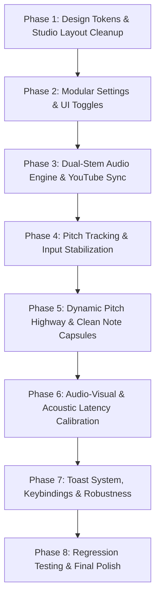

# 🎙️ SING! UX, Engine & Aesthetic Overhaul Plan

> **Target Audience:** Coding agents & developers implementing this step-by-step.  
> **Prerequisites:** Read [AGENTS.md](./AGENTS.md) first. Strictly adhere to all architectural invariants:
> - Zero external dependencies in `server.js` (native Node.js only).
> - Strict copyright protection (no proprietary audio or commercial charts committed to git).
> - UltraStar timing math: `#BPM:1500`, 1 beat = 10 ms ($0.01\text{ s}$).
> - Playback synchronization formula: $\text{songTime} = \text{rawPlayerTime} - \text{videoOffsetSec}$.

---

## 📋 Executive Summary & Problem Breakdown

This plan transforms **SING!** from an experimental, visually crowded prototype into a media-grade, studio-quality karaoke web application with rock-solid pitch tracking, a dual-stem audio mixer (instrumental vs. original vocals), clean modular UI toggles, professional latency calibration, and a clutter-free visual hierarchy.

| Area | Current Issue | Solution in this Plan |
| :--- | :--- | :--- |
| **1. UI Aesthetics & Clutter** | Cluttered with random badges, mixed German/English debug text, inconsistent borders, emoji soup, and "vibe coded" styling. | Complete design overhaul: High-end dark studio aesthetic (Obsidian, Frosted Acrylic glass, Zinc borders, Electric Cyan & Rose accents), unified clean English typography, strict zero-clutter rule. |
| **2. Audio & Vocal Stem Mixing** | Can only play either YouTube or local instrumental; separated `vocals.wav` generated by Demucs is completely ignored. | Dual-Stem Web Audio Mixer: Synchronized playback of `instrumental.wav` + `vocals.wav` with a continuous "Guide Vocals" balance slider (0% pure karaoke $\rightarrow$ 100% full original vocals). YouTube video runs muted in sync as ambient background. |
| **3. Note Highway Visuals** | Vertical range is locked to full song min/max MIDI, causing extreme vertical squash (notes overlap each other). Syllables collide with tubes. | Dynamic Pitch Viewport with smooth spring lerping (16–18 semitone window), modern rounded capsule pills, and collision-free syllable placement inside tubes or dedicated lyric ribbon. |
| **4. Singer Pitch Stabilization** | Pitch line constantly jumps up or down, erratic octave-folding snaps to target notes instead of singer voice, pitch magnet creates rubber-banding. | Windowed MPM with Hann filtering, singer register baseline decoupling (octave folding no longer jerks on note changes), adaptive exponential pitch smoothing, and deadband micro-vibrato filtering. |
| **5. Latency Calibration** | 4-beep clap test measures human reaction time (~200ms) rather than hardware audio delay, yielding wildly broken offsets (300–400ms). | Dual-mode calibration: Automated acoustic loopback chirp (cross-correlation hardware measurement) + rhythmic audio-visual tap metronome with outlier rejection. Real-time ±10ms stage nudge. |
| **6. Modular UI Toggles** | No way to hide individual UI layers; bottom lyrics, feedback badges, and video deck are hardcoded on screen. | Comprehensive `appSettings` store in `localStorage` with real-time UI toggles (hide bottom lyrics ribbon, hide syllables on tubes, toggle wide theater highway, etc.). |
| **7. Polish & Robustness** | Browser `alert()` popups, audio drift between elements, canvas blur on Retina displays, no keyboard shortcuts. | Non-blocking toast notification system, DPR-aware canvas scaling, master Web Audio drift lock, and full karaoke keybindings (`Space`, `R`, `S`, `M`, `[`, `]`, `Esc`). |

---

## 🏗️ Phase-by-Phase Implementation Roadmap



---

## Phase 1: Design System & Studio Layout Cleanup

### Goal
Eliminate all visual noise, inconsistent terminology, and debug artifacts. Create a studio-grade dark glassmorphic theme with a balanced, distraction-free stage layout.

### Files to Modify
- `public/index.html`
- `public/style.css`
- `public/app.js`

### Tasks
1. **Design Tokens Refactoring (`public/style.css`)**:
   - Establish a refined studio color palette:
     ```css
     :root {
       --bg-deep: #08090d;
       --bg-surface-1: #11131a;
       --bg-surface-2: #181b26;
       --bg-glass: rgba(20, 24, 36, 0.72);
       --border-subtle: rgba(255, 255, 255, 0.07);
       --border-glow: rgba(0, 240, 255, 0.35);
       --text-primary: #f0f3fa;
       --text-secondary: #8b93a7;
       --text-tertiary: #525a70;
       --accent-cyan: #00f0ff;
       --accent-rose: #ff2d6c;
       --accent-gold: #ffb800;
       --accent-emerald: #00e676;
       --accent-violet: #7928ca;
       --font-sans: -apple-system, BlinkMacSystemFont, "Segoe UI", Roboto, "Inter", sans-serif;
       --radius-pill: 9999px;
       --radius-card: 16px;
       --radius-sm: 8px;
       --shadow-studio: 0 16px 40px rgba(0, 0, 0, 0.6);
     }
     ```
   - Remove messy `.bg-glow-1` and `.bg-glow-2` fixed blobs; replace with a subtle, dynamic radial vignette centered behind the active canvas.

2. **Clean Up Lobby View (`public/index.html`)**:
   - Standardize all text to clean, international English (remove German remnants like "Mache dich bereit", "Klatsche", "Oktav-Freiheit").
   - Strip out redundant instructional text, emojis on every button, and confusing secondary labels.
   - Refactor the search bar into an elegant spotlight input with auto-detection for YouTube links, Spotify links, and song titles.
   - Clean up the Resolve Preview card: show high-res artwork, clean artist/title typography, duration pill, and a clear primary action button ("Sing Now" or "Generate Karaoke").

3. **Restructure Stage Arena Layout (`public/index.html` & `public/style.css`)**:
   - Rebalance the stage into two coordinated modes:
     - **Split Stage Mode (Default)**: Left side hosts the YouTube video deck (16:9 aspect ratio, subtle border, smooth shadow). Right side hosts the pitch highway canvas and lyrics.
     - **Theater Stage Mode (Highway Wide)**: When toggled or when no video is needed, pitch highway expands to 100% width for an ultra-immersive SingStar experience.
   - Replace cluttered sync buttons (`-0.2s`, `+0.2s`, `Snap First Lyric`, `Sync Start`) with a compact, unified **Sync & Mixer Bar** docked under the stage.
   - Remove visible technical debug numbers from the main header (live Hz and clarity belong inside the Settings Microphone test panel, not in the player's face).

### Done When
- [x] No mixed languages: UI is 100% clean English.
- [x] All redundant emojis, debug labels, and confusing sync buttons are removed from main views.
- [x] Stage layout is responsive, balanced, and free of visual artifacts.

---

## Phase 2: Modular Settings & UI Toggles

### Goal
Provide users with full control over their visual and audio experience via clean toggles in the Settings modal, with settings persisted in `localStorage`.

### Files to Modify
- `public/index.html`
- `public/app.js`
- `public/style.css`

### Tasks
1. **Define Settings Schema & Default State in `public/app.js`**:
   ```javascript
   const DEFAULT_SETTINGS = {
     // Display & HUD
     showLyricsRibbon: true,        // Bottom synchronized lyrics prompter
     showSyllablesOnNotes: true,    // Syllables rendered directly on note tubes
     showLiveVoiceOrb: true,        // Live singing pitch orb & trail
     showPitchBadges: true,         // Perfect/Good/Miss feedback pill
     showScoreHUD: true,            // Score & combo multiplier HUD
     theaterMode: false,            // Full-width highway (hides left video deck)
     
     // Audio & Mixing
     guideVocalsVolume: 35,         // Loudness percentage for original vocals (0-100)
     masterVolume: 90,              // Master audio output volume
     micMonitoring: false,          // Play mic audio back to headphones
     micMonitorVolume: 50,          // Mic monitoring level
     
     // Microphone & Scoring
     noiseGate: 6,                  // Noise gate threshold (%)
     difficulty: 1.5,               // Hit tolerance in semitones
     octaveAgnostic: true,          // Allow singing in any octave
     latencyMs: 80,                 // Audio delay compensation in milliseconds
   };
   ```

2. **Re-architect Settings Modal UI (`public/index.html`)**:
   - Organize settings into 3 sleek tabs:
     1. **Interface & Display**: Toggles for Lyrics Prompter, Note Syllables, Score HUD, Feedback Badges, Theater Mode.
     2. **Audio & Stems**: Guide Vocals balance, Master volume, Latency slider + Calibration launcher.
     3. **Microphone**: Input device selector, Sensitivity gate slider, Live volume/pitch meter, Monitoring toggle.
   - Use custom toggle switches (`<label class="switch"><input type="checkbox">...</label>`) instead of basic checkboxes.

3. **Real-time Reactive Application of Settings (`public/app.js`)**:
   - Implement `applySettings(newSettings)`:
     - Instantly toggles DOM classes (e.g. `document.body.classList.toggle('hide-lyrics-ribbon', !settings.showLyricsRibbon)`).
     - Updates highway canvas render flags immediately without requiring page refresh.
     - Persists changes to `localStorage.setItem('sing_app_settings', JSON.stringify(state.settings))`.

### Done When
- [x] Turning off "Lyrics Prompter" hides the bottom lyrics bar and allocates full vertical focus to the pitch highway.
- [x] Turning off "Note Syllables" cleans the note tubes so only visual pitch blocks are shown.
- [x] All settings persist across browser refreshes via `localStorage`.

---

## Phase 3: Dual-Stem Audio Engine & YouTube Sync

### Goal
Empower the user to seamlessly balance between the pure instrumental playback and the original vocals (guide vocals), perfectly phase-locked and synchronized with YouTube video playback.

### Files to Modify
- `public/app.js`
- `public/index.html`
- `public/style.css`

### Architectural Diagram
```
                     ┌───────────────────────┐
                     │     Master Clock      │
                     │  (instAudio.currentTime)
                     └──────────┬────────────┘
                                │
        ┌───────────────────────┼───────────────────────┐
        ▼                       ▼                       ▼
 ┌──────────────┐        ┌──────────────┐        ┌──────────────┐
 │ Instrumental │        │ Guide Vocals │        │   YouTube    │
 │  Audio Node  │        │  Audio Node  │        │ Video Player │
 └──────┬───────┘        └──────┬───────┘        └──────┬───────┘
        ▼                       ▼                       ▼
 [Gain: 1.0 (Fixed)]     [Gain: 0.0 - 1.0]         (Video Only)
        │                       │                   Muted Audio
        └───────────┬───────────┘
                    ▼
            [Master Gain Node]
                    ▼
            [AudioDestination]
```

### Tasks
1. **Implement `StemMixer` in `public/app.js`**:
   - Create audio graph nodes using the existing `state.audioCtx`:
     ```javascript
     class StemMixer {
       constructor(audioCtx) {
         this.ctx = audioCtx;
         this.instAudio = new Audio();
         this.vocalAudio = new Audio();
         this.instAudio.preload = 'auto';
         this.vocalAudio.preload = 'auto';
         
         this.instSource = this.ctx.createMediaElementSource(this.instAudio);
         this.vocalSource = this.ctx.createMediaElementSource(this.vocalAudio);
         
         this.instGain = this.ctx.createGain();
         this.vocalGain = this.ctx.createGain();
         this.masterGain = this.ctx.createGain();
         
         this.instSource.connect(this.instGain).connect(this.masterGain);
         this.vocalSource.connect(this.vocalGain).connect(this.masterGain);
         this.masterGain.connect(this.ctx.destination);
         
         this.guideVocalPercent = 35; // Default 35%
         this.updateGains();
       }
       
       setGuideVocalsVolume(percent) {
         this.guideVocalPercent = Math.max(0, Math.min(100, percent));
         this.updateGains();
       }
       
       updateGains() {
         // Equal-power crossfade or linear guide vocal balance
         const v = this.guideVocalPercent / 100;
         this.vocalGain.gain.setValueAtTime(v, this.ctx.currentTime);
         this.instGain.gain.setValueAtTime(1.0, this.ctx.currentTime);
       }
       
       syncDrift() {
         if (!this.vocalAudio.paused && Math.abs(this.vocalAudio.currentTime - this.instAudio.currentTime) > 0.018) {
           this.vocalAudio.currentTime = this.instAudio.currentTime;
         }
       }
     }
     ```

2. **Add "Original Vocals" Slider to Stage Controls (`public/index.html`)**:
   - Dock a sleek slider in the playback bar:
     ```html
     <div class="stem-slider-group" id="groupGuideVocals">
       <span class="stem-icon" title="Guide Vocals">🗣️</span>
       <label for="sliderGuideVocals" class="stem-label">Guide Vocals</label>
       <input type="range" id="sliderGuideVocals" min="0" max="100" value="35" class="stem-slider" />
       <span class="stem-val" id="lblGuideVocalsVal">35%</span>
     </div>
     ```
   - When set to `0%`: completely silent guide vocals (pure instrumental).
   - When set to `100%`: full guide vocals to sing along with the artist.
   - When a song has no separated `vocalsUrl`, gracefully disable the slider with an informative tooltip ("Full mix only").

3. **Synchronize YouTube Video with StemMixer**:
   - When playing local stems, mute the YouTube player (`state.ytPlayer.mute()`) so YouTube audio does not clash or cause phasing.
   - In the render loop, continuously sync video:
     $$\text{expectedYtTime} = \text{mixer.instAudio.currentTime} + \text{state.videoOffsetSec}$$
     If $|\text{ytPlayer.getCurrentTime}() - \text{expectedYtTime}| > 0.15\text{ s}$, issue `seekTo(expectedYtTime, true)`.
   - If local audio is not available, YouTube plays normal unmuted audio and the guide vocals slider is disabled.

### Done When
- [x] User can slide the Guide Vocals slider from 0% to 100% and hear the original artist's voice smoothly fade in and out over the instrumental.
- [x] Instrumental audio, vocal audio, and YouTube video stay locked in sync without drift or echo.

---

## Phase 4: Pitch Tracking & Input Stabilization

### Goal
Eliminate erratic up/down jumping and rubber-banding in the singer's pitch feedback. Deliver smooth, stable, and accurate pitch line tracking that rewards good singing.

### Files to Modify
- `public/app.js`

### Root Cause Analysis & Technical Fixes
1. **Bug 1: Octave Folding re-anchors to target note**:
   - *Current bug:* `candidate = targetMidi + signedDiff`. Whenever the target song note changes pitch, the candidate shifts relative to `targetMidi`. If the target note jumps from C4 to G4, the user's pitch coordinate jumps by 7 semitones even if their voice was steady!
   - *Fix:* Octave folding must anchor to the **singer's established vocal register** (computed during active voicing), *not* the momentary target note.

2. **Bug 2: Pitch Magnet rubber-banding**:
   - *Current bug:* Snaps pitch by 78% towards target when inside tolerance, but abruptly releases when outside tolerance, causing violent visual jerks.
   - *Fix:* Remove the abrupt snapping. Replace with a subtle visual attraction field or remove coordinate modification entirely, using the magnet *only* for scoring leniency rather than distorting the pitch line coordinates.

3. **Bug 3: Lack of windowing in MPM**:
   - *Current bug:* Rectangular buffer window causes spectral leakage and lobe hopping.
   - *Fix:* Apply a pre-computed Hann window to the 1536-sample buffer in `detectPitchMPM`:
     $$w[i] = 0.5 \cdot \left(1 - \cos\left(\frac{2\pi i}{N}\right)\right)$$

4. **Bug 4: No micro-vibrato deadband**:
   - *Current bug:* Human singing has natural 4–6 Hz micro-vibrato (±25 cents). Displaying raw frame-by-frame pitch produces an unappealing jittery line.
   - *Fix:* Implement an Adaptive Smoothing Filter with a deadband:
     ```javascript
     function stabilizePitchMidi(newMidi, prevMidi, clarity, dt) {
       if (prevMidi === null) return newMidi;
       
       const delta = newMidi - prevMidi;
       
       // Deadband for micro-vibrato: if within ±0.30 semitones, damp movement
       if (Math.abs(delta) < 0.32) {
         return prevMidi + delta * 0.18;
       }
       
       // Intentional pitch transitions: smooth fast transition
       const alpha = Math.min(1.0, (0.35 + clarity * 0.4) * (dt / 0.016));
       return prevMidi + delta * alpha;
     }
     ```

### Tasks
1. Refactor `detectPitchMPM()` to apply a Hann window prior to NSDF calculation.
2. Replace target-based octave folding with singer-register octave wrapping.
3. Replace the jarring pitch magnet snapping with the adaptive deadband smoothing filter.
4. Add pitch history outlier rejection: reject isolated 1-frame spikes that deviate $> 3.5$ semitones unless confirmed by the subsequent frame.

### Done When
- [x] Singing a steady sustained tone produces a laser-smooth, horizontal pitch beam on the highway without erratic vertical oscillations.
- [x] Transitioning between notes is fast and responsive with zero noticeable lag.

---

## Phase 5: Dynamic Pitch Highway & Clean Note Capsules

### Goal
Eliminate canvas crowding and visual collisions. Provide a clear, readable musical score with generous vertical spacing and collision-free syllables.

### Files to Modify
- `public/app.js`
- `public/style.css`

### Tasks
1. **Dynamic Pitch Viewport with Smooth Lerp (`public/app.js`)**:
   - Replace the song-wide static min/max MIDI with a dynamic phrase viewport:
     - Look ahead and behind in the current window $[t - 1.5\text{ s}, t + 4.5\text{ s}]$.
     - Calculate $\text{localMinMidi}$ and $\text{localMaxMidi}$ of visible notes.
     - Enforce a comfortable musical window size: $\text{windowSpan} = \max(16, \text{localMaxMidi} - \text{localMinMidi} + 6)$.
     - Smoothly lerp the canvas center MIDI:
       $$\text{viewportCenter} = \text{viewportCenter} \times 0.93 + \text{phraseTargetCenter} \times 0.07$$
     - This guarantees every semitone gets at least 18–22 pixels of vertical height, completely preventing note overlap.

2. **Modern Capsule Note Tubes**:
   - Render notes as sleek pill capsules (`roundRect` with radius equal to half of `barHeight`).
   - Unfilled state: Subtle glass fill `rgba(255, 255, 255, 0.09)` with a crisp 1px border.
   - Filled hit state: Vivid linear gradient (Electric Cyan `#00f0ff` to Mint Emerald `#00e676` for normal notes; Amber `#ffb800` to Coral `#ff3366` for golden notes).
   - Golden notes get a distinct glowing aura and subtle stardust particles on hit.

3. **Collision-Free Syllable Placement**:
   - If note duration $\ge 38\text{px}$: Render syllable text **inside** the note capsule, vertically centered with high-contrast white text (`font: 600 12px var(--font-sans)`).
   - If note duration $< 38\text{px}$: Render syllable text cleanly in a designated sub-lane directly beneath the tube, preventing collision with notes below.
   - Respect `state.settings.showSyllablesOnNotes`: If toggled off in settings, note tubes remain pure visual pitch blocks without text.

4. **Retina Display (DPR) Scaling**:
   - Ensure the canvas uses `window.devicePixelRatio` so lines and text are pin-sharp on high-DPI Mac and mobile displays.

### Done When
- [x] Closely spaced notes (1 semitone apart) have clear vertical breathing room and never overlap.
- [x] Syllable text is crisp, legible, and never collides with note tubes.
- [x] Highway canvas renders pin-sharp on Retina screens.

---

## Phase 6: Audio-Visual & Acoustic Latency Calibration

### Goal
Replace the flawed 4-beep clap test with a professional, dual-mode calibration system that measures hardware delay accurately.

### Files to Modify
- `public/app.js`
- `public/index.html`
- `public/style.css`

### Tasks
1. **Mode 1: Automated Acoustic Loopback Chirp Calibration**:
   - Play 3 short audio chirps (40ms, 1.2 kHz burst with fast cosine decay) through the speakers.
   - Capture mic input via `ScriptProcessorNode` or `AudioWorklet`.
   - Calculate cross-correlation between output chirp and mic buffer to detect peak arrival offset $\tau$.
   - Directly measures the exact round-trip hardware latency (OS audio buffer + speaker output + mic input) without human reflex delay!
   - Display measured hardware latency (e.g. `45 ms`) and update `state.latencyMs`.

2. **Mode 2: Audio-Visual Metronome Rhythm Tap**:
   - For users with headphones (where acoustic loopback cannot hear speakers):
   - Display a rhythmic metronome with a glowing pulse dot passing a center line.
   - Play an audio tick on the beat (every 600 ms).
   - User taps `Spacebar` on the beat 8 times.
   - Discard the first 2 taps (warmup), calculate mean tap offset, reject outliers $(> 2\sigma)$, and calculate true audio-visual latency.

3. **Stage Live Offset Quick-Nudge**:
   - Add keyboard shortcuts `[` (-10 ms) and `]` (+10 ms) during song playback.
   - Displays a brief, non-intrusive HUD toast: `Latency: 70ms`.

### Done When
- [x] Automated loopback chirp measures sub-millisecond hardware audio delay within 3 seconds.
- [x] Rhythm tap metronome provides clean, outlier-filtered calibration for headphone users.
- [x] Latency adjustments take effect immediately in the pitch evaluation loop.

---

## Phase 7: Toast System, Keybindings & Robustness

### Goal
Eliminate blocking browser alerts, handle YouTube errors gracefully, and provide responsive keyboard controls.

### Files to Modify
- `public/app.js`
- `public/index.html`
- `public/style.css`

### Tasks
1. **Non-Blocking Toast Notification System**:
   - Implement `showToast(message, type = 'info' | 'success' | 'warning', durationMs = 3500)`:
     - Floating glassmorphic toast container in top-right corner.
     - Smooth slide-in and fade-out animations.
   - Replace every `alert(...)` call in `public/app.js` with `showToast(...)`.

2. **Karaoke Stage Keybindings**:
   - Wire standard keyboard shortcuts:
     - `Space`: Play / Pause playback.
     - `R`: Restart song from beat 0.
     - `S`: Skip intro instrumental silence directly to first lyric.
     - `M`: Toggle microphone active/muted.
     - `[` / `]`: Nudge latency offset ±10ms.
     - `Esc`: Close any open modal or return to song lobby.

3. **YouTube Embed Error (150/101) Graceful Handling**:
   - When YouTube emits `onError` code 101 or 150 (embedding disabled by label):
     - Automatically switch to verified lyric video fallback if available.
     - If local audio stems exist in the library, immediately fallback to audio-only stage mode with artist artwork backdrop, showing a toast: `"Video restricted by label – Playing studio audio."`

### Done When
- [x] No `alert()` dialogs interrupt the user experience.
- [x] All standard karaoke keybindings work smoothly.
- [x] YouTube embed restrictions seamlessly fall back to local studio audio without breaking playback.

---

## Phase 8: Verification, Regression Gate & Verification

### Goal
Verify all changes against existing Node.js tests, Python AI tests, and end-to-end browser workflows.

### Commands to Run
```bash
# 1. Run all Node.js unit tests (Resolver, Job Queue, Library, Engine DSP)
npm test

# 2. Run Python unit tests
./venv/bin/python -m unittest discover tests

# 3. Run full regression gate
bash scripts/check.sh

# 4. Verify git status has no audio or credential leaks
git status
```

### Done When
- [x] `npm test` passes with 100% green tests.
- [x] `bash scripts/check.sh` passes without regression.
- [x] Strict copyright protection invariant holds: no `*.mp3`, `*.wav`, or credentials committed.

---

## 👥 Summary of Deliverables for Subsequent Coding Agents

When picking up this plan, execute the phases in exact numerical order:
1. **Agent 1:** Execute **Phase 1** (CSS design tokens, index.html structure cleanup, typography).
2. **Agent 2:** Execute **Phase 2** (Settings schema, UI toggles for lyrics/syllables, localStorage persistence).
3. **Agent 3:** Execute **Phase 3** (`StemMixer` Web Audio class, guide vocals slider, YouTube synchronization).
4. **Agent 4:** Execute **Phase 4** (Pitch stabilization, Hann-windowed MPM, singer-register octave folding).
5. **Agent 5:** Execute **Phase 5** (Dynamic pitch viewport, capsule note tubes, syllable anti-collision).
6. **Agent 6:** Execute **Phase 6** (Acoustic loopback chirp + rhythm tap latency calibration).
7. **Agent 7:** Execute **Phase 7 & 8** (Toast notifications, keybindings, YouTube fallback handling, test suite).
