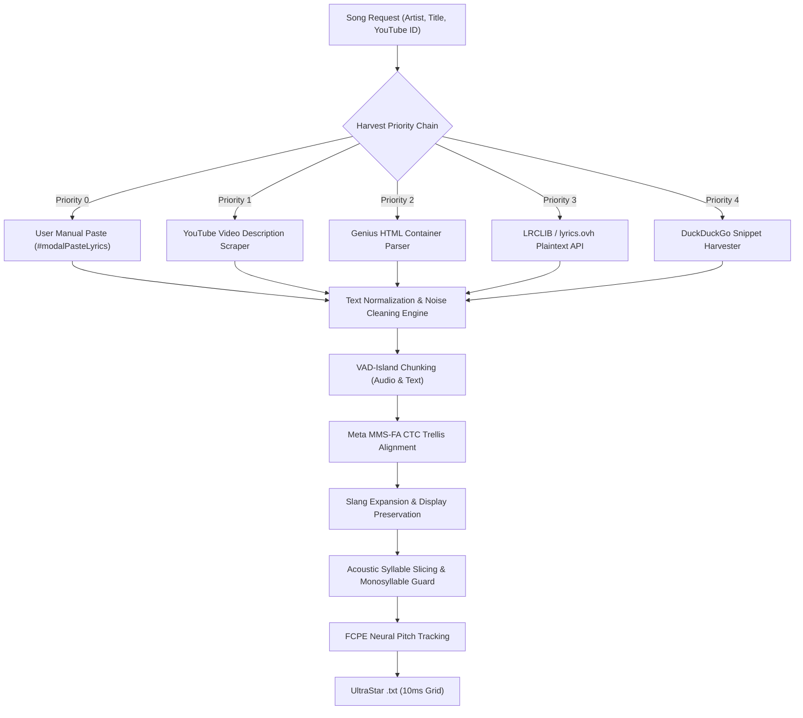

# 🌾 Plain-Text Lyrics Harvester & Meta MMS-FA Forced Alignment

This document outlines the architecture, data flow, and normalization algorithms powering **Tier 3 (Web Lyrics + Meta MMS-FA Forced Alignment)** in the SING! engine.

---

## 🚀 The Tier 3 Pipeline Flow

---

## 🧹 1. Multi-Source Harvester (`lib/lyrics_harvester.js`)

When synced syllable lyrics (Tier 2) are unavailable, `lib/lyrics_harvester.js` queries 5 prioritized sources with disk caching in `lyrics_cache/harvester/`:

### 1. Priority 0: Manual User Override
- Users can click **"Songtext einfügen"** (`#btnOpenPasteLyrics`) on the stage lobby or **"Upgrade to Tier 3"** (`#btnUpgradeLyrics`) in their song library.
- Custom text completely bypasses cache and remote lookups.

### 2. Priority 1: YouTube Description Scraper
- Automatically extracts official lyrics published directly by artists and record labels in video descriptions.
- **Cleaning Filters**:
  - Strips video production credits: `Video:`, `Director:`, `Mix:`, `Mastering:`, `Label:`, `Car:`.
  - Removes social media handles and streaming URLs: `https://instagram.com/...`, `https://spoti.fi/...`.
  - Strips guitar chord charts (`Am C G D`, `Em7 A7 Dsus4 G`) and inline chords (`[Am]Text [G]zeile`).
  - Removes structural markers (`[Verse]`, `[Chorus]`, `HOOK`, `STROPHE 1`).

### 3. Priority 2: Genius Container Parser
- Extracts lyrics from modern Genius server-rendered HTML payloads using regex matching on `
`.
- Filters out non-lyrical metadata headers like `
` and `Contributors` buttons.

### 4. Priority 3: LRCLIB & lyrics.ovh API
- Fast JSON endpoints querying open lyrics repositories.

### 5. Priority 4: DuckDuckGo Snippet Harvester
- Queries search engine snippets for queries like `"{Artist} {Title} lyrics"`.
- Extracts slash-delimited lines (e.g. `Line 1 / Line 2 / Line 3 / Line 4`) while stripping HTML tags.

---

## ⚡ 2. Meta MMS-FA Forced Alignment Engine (`karaoke/align_mms.py`)

Once clean plaintext lyrics are secured, they are aligned against Demucs-isolated vocals using Meta’s multilingual **MMS-FA (Massively Multilingual Speech - Forced Alignment)** acoustic model.

### Key Invariants & Algorithms

#### 1. VAD-Island Chunking (Zero-Drift Guarantee)
- **Problem**: Standard global CTC forced alignment drifts when a song contains a long instrumental guitar solo, intro, or outro, stretching words across non-vocal sections.
- **Solution**: The audio is analyzed via Silero VAD. Regions separated by pauses $> 1.2\text{ s}$ form independent `VocalIsland` chunks.
- Plaintext lyrics are split into matching stanzas and aligned independently per island.
- **Result**: **0% word leakage into guitar solos or instrumental breaks**.

#### 2. Slang & Contraction Normalization Pre-Pass
- **Problem**: MMS-FA's CTC dictionary does not contain colloquial contractions (`fahr'n`, `gonna`, `is`), leading to character misalignment.
- **Solution**: A dual-token representation:
  - **Clean CTC Tokens**: Expanded via `GERMAN_SLANG_MAP` (`fahr'n` $\rightarrow$ `fahren`, `is` $\rightarrow$ `ist`, `nich` $\rightarrow$ `nicht`) and `ENGLISH_SLANG_MAP` (`gonna` $\rightarrow$ `goingto`, `wanna` $\rightarrow$ `wantto`).
  - **Highway Display Word**: Retains original slang (`fahr'n`, `gonna`) so the user sees the true artist wording on the karaoke highway.

#### 3. Acoustic Syllable Slicing & Monosyllable Protection
- Words are sliced into syllables using phonetic dictionary rules and Pyphen.
- **Invariant**: Words listed in `MONOSYLLABLE_WORDS` (*dance, breathe, please, voice, light, traum, glück, sehn*) or words with duration $< 0.28\text{ s}$ are **never split**.

#### 4. Micro-Snapping & Pitch Quantization
- Syllable onsets snap to the nearest acoustic vocal energy rise.
- Neural pitch curves extracted by FCPE are median-filtered and quantized onto the UltraStar 10 ms grid (`#BPM:1500`).
