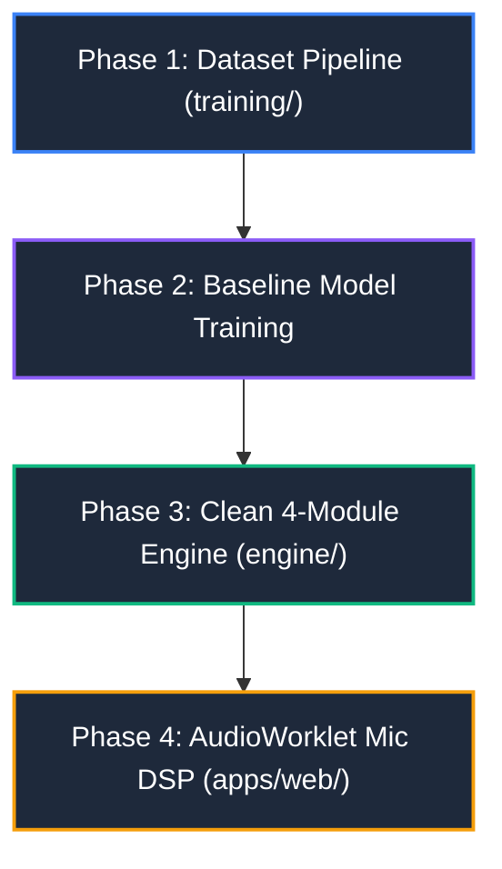

# 🎙️ SING 2.0: Architectural Blueprint & Rebuild Strategy
**A Post-Mortem of 62 Iterations and the Path to a Clean, Neural-Powered Singing Engine**

---

## 📋 Table of Contents
1. [Executive Summary](#1-executive-summary)
2. [The Post-Mortem: Why the Legacy Pipeline Failed](#2-the-post-mortem-why-the-legacy-pipeline-failed)
3. [The Pitch Problem: Physical Frequency vs. Musical Notes](#3-the-pitch-problem-physical-frequency-vs-musical-notes)
4. [GitHub Issues Analysis: Issue #5 vs. Issue #6](#4-github-issues-analysis-issue-5-vs-issue-6)
5. [The Tri-Source Data Fusion Solution](#5-the-tri-source-data-fusion-solution)
6. [Neural Architecture: Dedicated Syllable-Note Model](#6-neural-architecture-dedicated-syllable-note-model)
7. [Real-Time In-Browser Microphone Scoring Fix](#7-real-time-in-browser-microphone-scoring-fix)
8. [The "Sing 2.0" Repository Structure](#8-the-sing-20-repository-structure)
9. [Compute, Hardware, & Cost Realities](#9-compute-hardware--cost-realities)
10. [Phased Implementation Roadmap](#10-phased-implementation-roadmap)

---

## 1. Executive Summary

Over the course of 62 development chats and 6 architectural overhauls, the SING project has grown into a highly complex, fragile web of interacting scripts, heuristics, genetic algorithm tuners, and dynamic programming matrices. Despite extensive optimization, generated pitch charts often feel out-of-tune, jittery, or out of sync, and real-time player scoring is frequently frustrating.

This document presents a comprehensive diagnostic of **why** that happened, why free general-purpose models (CREPE, Whisper, Spotify Basic-Pitch) fail for singing games, and how **Sing 2.0** solves this once and for all:
- **Clean Architectural Slate**: Deprecating the 20+ heuristic and glue scripts in favor of a clean, isolated 4-module pipeline.
- **Tri-Source Data Fusion (Issue #6)**: Harnessing 25,000+ USDB human note charts matched with SpicyLyrics millisecond syllable timestamps to automatically create a ~3.5 million clip singing dataset with **zero manual labeling**.
- **Dedicated Neural Singing Transcriber**: Training a lightweight (~15M parameter) Syllable Audio Spectrogram Transformer (AST) that converts vocal syllable audio slices directly into discrete musical MIDI notes and melisma transitions, eliminating rule-based heuristic splitting.
- **AudioWorklet Microphone DSP**: Replacing unstable in-browser McLeod Pitch Method (MPM) octave leaps with stabilized Yin/HMM or micro-ONNX tracking.

---

## 2. The Post-Mortem: Why the Legacy Pipeline Failed

The legacy system suffered from what is known in Music Information Retrieval (MIR) as the **Cascading Heuristic Trap**:

```
[Audio] ➔ Demucs ➔ Whisper/MMS ➔ FCPE/CREPE ➔ Consonant Shaving ➔ HSMM/Splitting ➔ Quantizer
 (0.95)     (0.92)         (0.90)           (0.85)             (0.80)            (0.88)
 ─────────────────────────────────────────────────────────────────────────────────────────
 End-to-End System Reliability: 0.95 × 0.92 × 0.90 × 0.85 × 0.80 × 0.88 ≈ 47%
```

### Key Failure Modes:
1. **Error Compounding**: When 7 independent components are chained together, a 5% inaccuracy in stem separation, a 50 ms drift in Whisper phoneme alignment, or an octave burp in CREPE corrupts all downstream processing.
2. **The "Band-Aid Spiral"**:
   - Step 1: Notes were jittery $\to$ added heuristic splitting.
   - Step 2: Melismas were missed $\to$ added genetic algorithm optimizer (`optimizer.py`) tuning 12 weights.
   - Step 3: Vibrato broke the notes $\to$ added Hidden Semi-Markov Model (HSMM) dynamic programming trellis.
   - Step 4: Transients caused false notes $\to$ added Harmonic Octave Continuity Filter (HOCF) and consonant trimming.
   Each patch introduced 3 new edge cases, turning the codebase into an unmaintainable monolith.
3. **The "Dual Pitch" Illusion**:
   When singing in the browser feels completely broken, two separate issues are multiplying:
   - **Offline Chart Flaw**: The generator assigned a note 1 semitone flat or mistimed the start.
   - **Online Microphone Flaw**: The browser's McLeod Pitch Method (MPM) jumped an octave on a baritone or picked up background noise.
   The singer sings the correct pitch, gets a red "miss" bar, and blames the entire system.

---

## 3. The Pitch Problem: Physical Frequency vs. Musical Notes

Why do existing free audio tools struggle with singing?

| Tool | What It Does | Why It Fails for Karaoke Charts |
| :--- | :--- | :--- |
| **CREPE / FCPE / pYIN** | Estimates physical fundamental frequency ($f_0$ in Hz) per 10 ms frame. | Output is a continuous oscillating curve. Human vocal vibrato naturally swings $\pm 1.5$ semitones at 5–6 Hz. Scoops and vocal fry create noise. Continuous Hz is **not** discrete musical notes. |
| **Whisper / MMS** | Speech-to-Text & Phoneme Alignment. | Transcribes spoken words and word timestamps, but has **zero concept of musical pitch, key, or scale**. |
| **Spotify Basic-Pitch** | Polyphonic music transcription. | Trained on general polyphonic instruments (guitars, pianos, organs). On vocals, it interprets natural vibrato as machine-gun repeated 16th notes and fails to track vocal formants. |

To create game-ready UltraStar charts, we must bridge the gap between **continuous vocal acoustics** and **discrete musical perception**.

---

## 4. GitHub Issues Analysis: Issue #5 vs. Issue #6

Recent discussions on the project repository ([codeggerer/SING](https://github.com/codeggerer/SING)) highlighted two potential directions:

### Issue #5: Train a Lightweight Melisma & Note Transition Classifier
- **The Concept**: Train a tiny micro-classifier (< 200k parameters) to make a single binary decision: *"Does this vocal syllable contain more than one note, and where does it split?"*
- **The Limitation**: While well-intentioned, it was still a band-aid on a broken paradigm. It still assumed upstream syllable timestamps were flawless and still left pitch assignment to fragile heuristics.

### Issue #6: Tri-Source Data Fusion & Syllable Pitch Model Architectures
- **The Concept**: Solve the data bottleneck that has blocked the MIR field for a decade.
- **The Core Realization**: You cannot train an end-to-end model from scratch because there is no massive paired singing dataset with both syllables and notes. **However**, all the necessary data already exists across three independent public ecosystems.

---

## 5. The Tri-Source Data Fusion Solution

Instead of manual human annotation (which would take thousands of hours), we synthesize a massive, clean training dataset by intersecting three available sources:

```
┌─────────────────────────────────┐      ┌─────────────────────────────────┐
│     SpicyLyrics / Apple Music   │      │        USDB Community           │
│  - Millisecond Syllable Timing  │      │  - Human-Curated MIDI Notes     │
│  - Studio-Quality Boundaries    │      │  - 25,000+ Pop/Rock Songs       │
│  - NO pitch information         │      │  - Inconsistent Audio Timestamps│
└────────────────┬────────────────┘      └────────────────┬────────────────┘
                 │                                        │
                 └──────────────────┬─────────────────────┘
                                    │ String-Match & Monotone DTW
                                    ▼
                 ┌────────────────────────────────────────┐
                 │   Aligned Dataset of Ground Truth:     │
                 │   - Syllable Audio Slice (.wav)        │
                 │   - Exact Millisecond Window (t0, t1)  │
                 │   - True Target MIDI Pitch(es)         │
                 │   - Melisma Note Transition Points     │
                 └────────────────────────────────────────┘
```

### Dataset Scale:
- **~10,000 matched songs** $\times$ **~350 syllables/song** $\approx$ **3.5 million labeled syllable audio clips**.
- Covers diverse vocal timbres, vibrato styles, vocal registers, and genres.
- 100% automated extraction pipeline.

---

## 6. Neural Architecture: Dedicated Syllable-Note Model

Rather than predicting entire 3-minute songs autoregressively (which causes sequence drift and hallucinations), the model is conditioned on the bounded syllable audio slice ($150\text{ ms} - 800\text{ ms}$):

```
Audio Syllable Slice [t_start ... t_end]
              │
              ▼
    Log-Mel Spectrogram (128 bins, 10ms hop)
              │
              ▼
   ┌───────────────────────────────────────────┐
   │ Syllable-AST / Conformer Encoder (~15M)  │
   │ (Self-Attention + Depthwise Convolution)  │
   └─────────────────────┬─────────────────────┘
                         │
         ┌───────────────┼───────────────┐
         ▼               ▼               ▼
   [Pitch Head]    [Melisma Head]  [Transition Head]
   Softmax (128)   Class (1, 2, 3)  Regression [0.0 - 1.0]
   MIDI Note #     Notes in Syllable Relative Split Point
```

### Why This Outperforms Heuristics:
1. **Learned Vibrato Invariance**: The transformer layers learn that periodic pitch fluctuations around 5–6 Hz are vocal ornamentations belonging to a single musical pitch class, not distinct note triggers.
2. **Zero Sequence Drift**: Errors cannot cascade into subsequent measures. If syllable $N$ has poor separation, syllable $N+1$ begins fresh with its own true boundary.
3. **Ultra-Fast Inference**: A 15M parameter model exported to ONNX runs in $\approx 1.5\text{ ms}$ per syllable on standard CPU/Apple Silicon. An entire 400-syllable song transcribes in **under 1 second**.

---

## 7. Real-Time In-Browser Microphone Scoring Fix

To fix the in-game singing experience where players feel "the pitch detection is horrible":

### Root Cause in Legacy Client:
- `public/app.js` runs the **McLeod Pitch Method (MPM)** directly on short 1536-sample time-domain buffers.
- MPM is susceptible to **octave jumping** (doubling or halving the detected frequency, especially on low male voices or high falsetto) and unvoiced consonant confusion.

### The Sing 2.0 Solution:
1. **Web Audio AudioWorklet**: Offload pitch DSP from the main UI thread to a dedicated low-latency `AudioWorkletNode`.
2. **Yin-FFT with Temporal Viterbi Smoothing**:
   Implement a lightweight Hidden Markov Model (HMM) running over the last 5 pitch frames. Penalize instantaneous 12-semitone jumps unless sustained for $> 60\text{ ms}$.
3. **Optional Micro-ONNX Evaluator**:
   Run a quantized 500 KB ONNX model (SPICE / micro-CREPE) directly inside the browser using WebAssembly / WebGPU for noise-robust pitch extraction.

---

## 8. The "Sing 2.0" Repository Structure

The new repository completely segregates runtime game code, offline generation, and neural training. No more monolithic folders or tangled dependencies:

```text
sing-v2/
├── apps/
│   ├── web/                          # Zero-Bloat Interactive Karaoke Client
│   │   ├── index.html                # Clean Single-Page Arena Shell
│   │   ├── app.js                    # Canvas Highway & Game Loop
│   │   ├── audio-worklet-pitch.js    # Stabilized Realtime Mic Pitch Processor
│   │   └── style.css                 # Dark Glassmorphism Styling
│   └── server/
│       └── server.js                 # Zero-dependency Node.js HTTP/API gateway
│
├── engine/                           # The 4-Module Generation Pipeline (CLI & API)
│   ├── models/
│   │   └── sing_ast.onnx             # Portable compiled neural transcriber (< 25 MB)
│   ├── separate.py                   # Vocal stem separation (Mel-Band RoFormer / Demucs)
│   ├── align.py                      # Lyric-to-Audio syllable boundary alignment (MMS-FA)
│   ├── transcribe.py                 # ONNX Syllable-Note inference
│   ├── chart.py                      # UltraStar .txt formatting & beat quantization
│   └── run.py                        # Single CLI entry point: run.py song.mp3 "Artist" "Title"
│
├── training/                         # Standalone Offline ML Environment
│   ├── 01_fetch_usdb.py              # USDB chart scraper & parser
│   ├── 02_fuse_dataset.py            # Tri-Source alignment & ground truth extraction
│   ├── 03_extract_spectrograms.py    # Precomputes 128-bin log-mel HDF5 caches
│   ├── model.py                      # PyTorch Syllable-AST / Conformer architecture
│   ├── train.py                      # Training loop with CTC & Cross-Entropy loss
│   └── export_onnx.py                # Validation and ONNX export pipeline
│
└── tests/
    └── test_public_domain.py         # End-to-end regression tests on royalty-free audio
```

---

## 9. Compute, Hardware, & Cost Realities

A common fear when proposing "train our own network" is that it requires a supercomputer or tens of thousands of dollars. Because our model operates on **bounded syllable slices** rather than raw hours of multi-track audio, the requirements are surprisingly modest:

| Phase | Compute Workload | Hardware Recommendation | Estimated Cost |
| :--- | :--- | :--- | :--- |
| **Dataset Creation** | Stem separation on 5,000–10,000 songs | Apple Silicon (M-series) or 1x RTX 4090 / Cloud RunPod (~40–60 GPU hrs) | \$15 – \$25 on RunPod (or \$0 locally) |
| **Model Training** | 15M param Conformer, 3.5M syllable clips, 30 epochs | 1x NVIDIA A100 (80GB) or RTX 4090 for ~24 hours | \$20 – \$35 on Lambda / RunPod |
| **Production Runtime** | ONNX inference per song | Any standard modern CPU (Mac, Windows, Linux) | **\$0.00** (Local inference in < 2 seconds) |

---

## 10. Phased Implementation Roadmap

To avoid slipping into another open-ended cycle, development should proceed in four strictly bounded phases:



### Phase 1: Tri-Source Dataset Fusion (Weeks 1–2)
- Implement `training/01_fetch_usdb.py` and `training/02_fuse_dataset.py`.
- Run on an initial batch of 250 common songs to extract ~80,000 verified syllable clips.
- Inspect the output clips to confirm note accuracy.

### Phase 2: Neural Syllable Transcriber (Weeks 2–3)
- Define the 15M-parameter AST / Conformer architecture in `training/model.py`.
- Train baseline on the extracted dataset.
- Evaluate pitch classification accuracy and melisma detection rate against ground truth.
- Export to `sing_ast.onnx`.

### Phase 3: The Simplified Generation Pipeline (Week 4)
- Build the 4 clean production files in `engine/` (`separate.py`, `align.py`, `transcribe.py`, `chart.py`).
- Benchmark on complete songs: confirm that charts generate cleanly without false trills or jitter.

### Phase 4: AudioWorklet Mic DSP & Web App Polish (Week 5)
- Replace legacy MPM in `apps/web/` with temporal Viterbi smoothing in an AudioWorklet.
- Connect the web interface to the new generation backend.
- Celebrate a clean, maintainable, high-accuracy singing game!
